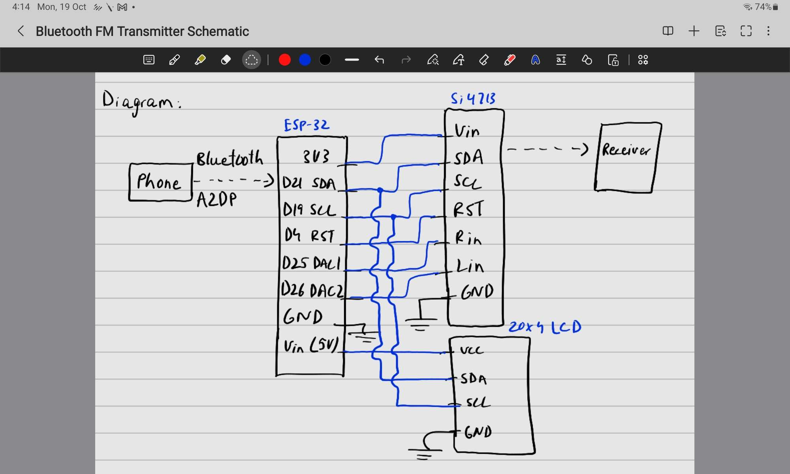
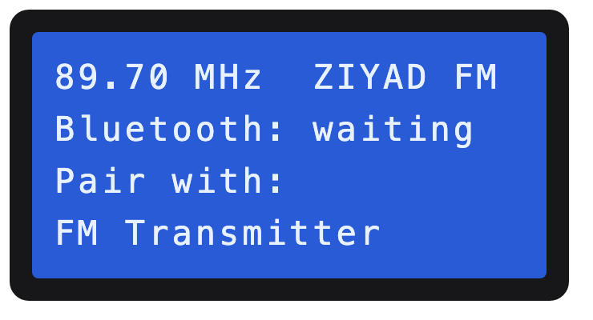
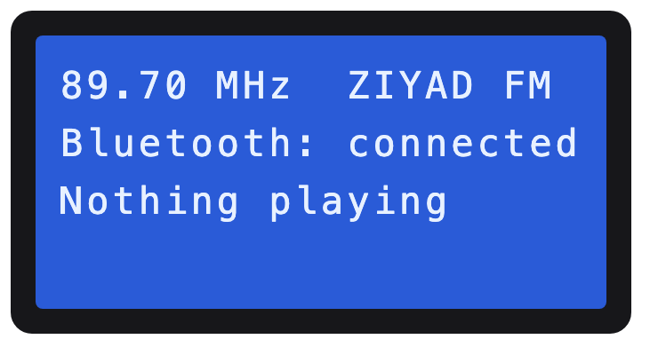
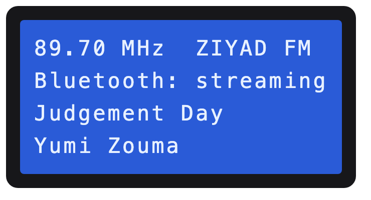
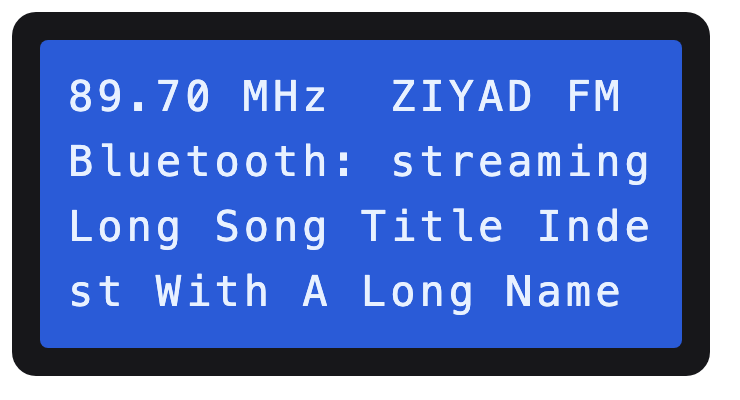

# Bluetooth FM transmitter

Phone streams music over Bluetooth A2DP to an ESP32 (original WROOM-32). The ESP32 decodes it, feeds a DAC, and a Si4713 broadcasts it on FM. A 20x4 LCD shows status.

- `firmware/fm_transmitter/` - current firmware (arduino-cli sketch), see Code layout below.
- `si4713_test/` - old ESP32-C5 bring-up sketch, kept for reference only.

## Schematic



Hand-drawn wiring sketch: The two audio lines, D25 to RIN and D26 to LIN, each go through a 220k series resistor.

## What the LCD shows

The 20x4 display shows the frequency and RDS station name, the Bluetooth state, and the track title and artist (long text scrolls). The BOOT button turns the whole screen on and off. These are renders of the firmware's layout, not photos of the real display.

| Waiting for a phone | Connected, nothing playing |
|---|---|
|  |  |

| Streaming | Long title (scrolls) |
|---|---|
|  |  |

| Screen off (BOOT button) |
|---|
|  |

## Code layout (`firmware/fm_transmitter/`)

The sketch root holds just the entry point and the tunables. Everything else lives in `src/`, which Arduino compiles recursively, grouped by what it does:

| Path | Role |
|---|---|
| `fm_transmitter.ino` | Entry point: runs the bring-up console or the full app, chosen by `BRINGUP_MODE` |
| `config.h` | Every tunable and pin assignment |
| `sketch.yaml` | Board, partition scheme and flash mode |
| `src/app/` | `app.*`: the full firmware, wiring radio, Bluetooth, LCD and button together |
| `src/radio/` | `si4713.*` driver (start-up, tune, power, stereo/mono, noise measure, ASQ, RDS); `radio_service.*` keeps it transmitting with health check and auto-recovery; `channel_scan.*` finds the quietest channels |
| `src/bluetooth/` | `bt_audio.*`: A2DP sink, fixed output level, connection state, AVRCP title/artist; `i2s_output.*`: our I2S output for the PCM5102A (starts the clocks with the audio, follows the phone's sample rate) |
| `src/display/` | `lcd_pcf8574.*`: our own HD44780-over-PCF8574 driver; `display.*`: what the 20x4 LCD shows |
| `src/input/` | `button.*`: debounced push button |
| `src/util/` | `utils.*`: I2C setup and scan, frequency printing, ASCII sanitising |
| `src/bringup/` | `bringup.*`: serial console driven by a command table; `test_tone.*`: test tones from the internal DAC, PWM or the I2S DAC (bring-up only) |

Headers include each other with relative paths (for example `../radio/si4713.h`), so nothing depends on Arduino's include search.

## Build

```bash
arduino-cli compile firmware/fm_transmitter
arduino-cli upload -p <port> firmware/fm_transmitter
```

`sketch.yaml` sets the board to `esp32:esp32:esp32` with the `huge_app` partition (Bluetooth Classic is too big for the default) and `FlashMode=dio` (some of these dev boards won't boot in QIO). Choose the audio backend by editing `AUDIO_BACKEND` in `config.h`; don't override `build.extra_flags`, which breaks the AudioTools build.

Libraries: ESP32-A2DP v1.8.9 and arduino-audio-tools v1.2.6 (installed from git). The Si4713 and LCD drivers are our own; the Adafruit Si4713 and hd44780 libraries were only used as references.

## Stage 1 bring-up console

With `BRINGUP_MODE 1` in `config.h` the board runs a serial console (115200 baud, newline-terminated) that drives the Si4713 with no Bluetooth: `tune 88.1`, `power 88`, `info`, `scan`, `asq`, `watch`, `tone on 1000` (internal DAC) / `tone pwm 1000` / `tone i2s 1000` (through the PCM5102A), `stereo off`, `pre 50`, `lim on`, `line 3 636`, `reinit`, `help`. `BRINGUP_MODE 0` (the current default) runs the full firmware.

## Pins (see `config.h`)

| Function | ESP32 pin |
|---|---|
| I2C SDA / SCL (Si4713) | 21 / 19 |
| LCD I2C SDA / SCL (own bus, Wire1) | 13 / 14 |
| LCD power | VIN (5 V) or 3V3, GND |
| LCD on/off button | GPIO0 (the BOOT button) |
| Si4713 RST | 4 |
| I2S BCK / WS / DATA (PCM5102A) | 27 / 25 / 26 |
| Internal DAC (fallback) | 25 (DAC1), 26 (DAC2) |
| PWM test tone L / R | 18 / 23 |
| Buttons up / down | 32 / 33 |

ESP32-A2DP v1.8.x defaults to BCK14/WS15/DATA22, so pins are set explicitly in code.

## PCM5102A DAC wiring

The audio path is A2DP -> ESP32 -> I2S -> Adafruit PCM5102A -> Si4713 line input.

| DAC pin | Goes to |
|---|---|
| VIN | ESP32 3V3 |
| GND | ESP32 GND |
| BCK | ESP32 D27 (GPIO27) |
| WSEL | ESP32 D25 (GPIO25) |
| DIN | ESP32 D26 (GPIO26) |
| Lout | 220k resistor, then Si4713 LIN |
| Rout | 220k resistor, then Si4713 RIN |
| G (analog ground) | Si4713 GND |
| MU, FM, DE, FIL, MCK, 3V | leave alone |

- Solder only the five header pins you need. **Don't bridge MU and FM**: they set mute and format (MU must be high, FM low) and tying them together mutes the DAC.
- The 220k resistors with the Si4713's 60k input scale the DAC's ~2 Vrms to about 640 mV peak, the chip's limit, so the digital volume stays at full scale (`A2DP_FIXED_VOLUME` 4096).
- The DAC's jack and its Lout/Rout pins are the same output. Don't drive headphones from it: it is a line-level output and will clip into low-impedance loads.

## Things to remember

- The Si4713 breakout exposes only RST, CS(SEN), SCL, SDA, GP1, LIN, RIN (plus a 3.5 mm jack in parallel with LIN/RIN). DFS/DIN/DCLK aren't available, so audio is analog only.
- Max line input is 636 mVpk. The PCM5102A outputs 2.1 Vrms (~2.97 Vpk), so each channel goes through a ~220 kohm series resistor (Si4713 LIATTEN=3, 60 kohm input).
- LIN/RIN must be AC-coupled (datasheet uses 0.47 uF); Adafruit's guide says the breakout has the blocking capacitor on board.
- Si4713 stereo SNR is ~58 dB typical, so the chip, not the DAC, limits quality. Mono (`FM_STEREO 0`) drops the stereo pilot and difference channel for a cleaner link on a weak signal; RDS stays on.
- Transmit power (`FM_TX_POWER_DBUV`) is 100 for range testing. Australian low-power FM rules are strict and the exact limit wasn't confirmed, so keep it as low as works and check ACMA.
- The wire antenna is very sensitive to what is near or touching it (a patch of Play-Doh against a wall ruined the range). Keep it straight, vertical and free-standing.
- While streaming, the serial log prints `Audio in-level` every 2 s from the Si4713's input meter: about -60 dBFS means silence is reaching the chip. At start-up it prints the modulation settings read back from the chip.
- Pre-emphasis: 50 us for Australia (chip default is 75 us). Default deviation (68.25 kHz + 6.75 kHz pilot) is already within the 75 kHz limit.
- The Adafruit library's `powerUp()` writes 0 to `TX_ACOMP_ENABLE`, which I believe disables the limiter; our driver should set it to 0x0002.

## Stages

0. Scaffolding: layout, config, libraries, compile check on both audio backends. Done.
1. Radio over I2C: custom Si4713 driver, tune + status readback, noise scan, tone test. Done. 
2. Core audio path: A2DP -> PCM5102A (I2S) -> Si4713 with AVRCP metadata, RDS and chip auto-recovery. Done.
3. LCD: frequency, Bluetooth state, scrolling track/artist. Done.
4. Buttons, saved frequency, power-bank test, backup photos/video.

## Known issues

- The Si4713 reset itself several times on the bench when the antenna wire was moved or handled. Stable once the soldered antenna was left alone; `RadioService` recovers automatically if it happens again.
